

# Servidor HPC para LLM: Despliegue, Benchmarking y Operaciones SRE

    

        <strong>Autor:</strong> Juan Luis Torres Ramos 
        <strong>Supervisores:</strong> Alberto Guillén Perales y Juan Manuel Tenorio del Moral     <strong>Universidad de Granada</strong> 
        <strong>Fecha:</strong> 09/06/2025
    

    

        
    

<!-- ---
title: Índice
layout: side-title
color: amber-light

side: l
titlewidth: is-3
align: cm-lm

transition: slide-left

:: title ::
# Índice

:: content ::

<ol class="ol-amber ml-6 space-y-4 text-base">
  <li>Introducción y Motivación</li>
  <li>Objetivos</li>
  <li>Estado del Arte</li>
  <li>Propuesta y Metodología</li>
  <li>Infraestructura y Puesta a Punto</li>
  <li>Ejecución de LLM en Contenedores</li>
  <li>Evaluación de Rendimiento</li>
  <li>Gestión Operativa y SRE</li>
  <li>Conclusiones y Trabajos Futuros</li>
</ol> -->

---
title:  Introducción y Motivación
layout: top-title-two-cols
color: amber-light

align: l-lm-cm
columns: is-4

transition: slide-left
---

:: title ::
# Introducción y Motivación

:: left ::

<ol class="ol-amber ml-6 space-y-4 text-base">
  <li>Era de los Datos</li>
  <li>High Performing Computing</li>
  <li>AlphaFold y Human Brain Project</li>
  <li>Alta demanda de LLM y practicas SRE</li>
</ol>

:: right ::
<figure class="flex flex-col justify-center h-full">
  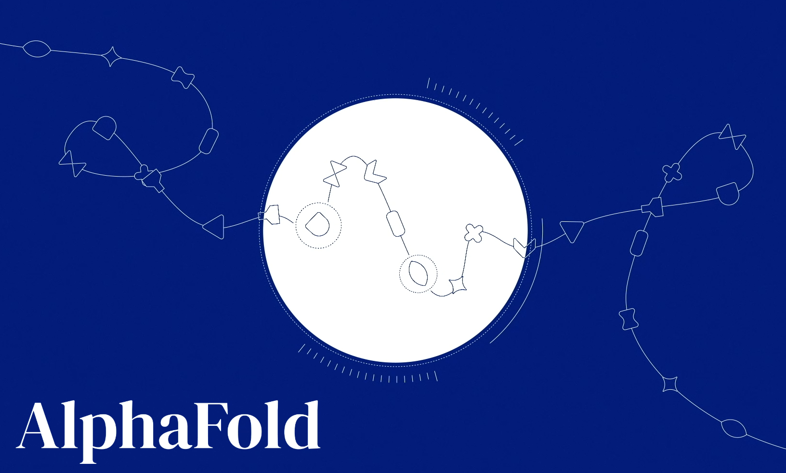
  <figcaption class="text-center text-sm text-gray-600" style="margin-top: 0.7rem;">
    AlphaFold: Artificial intelligence program by DeepMind (Google)
  </figcaption>
</figure>

<!-- 
Importancia de HPC y LLMs en la actualidad
Retos: escalabilidad, fiabilidad y seguridad
Motivación personal y profesional
-->

---
title: Objetivos Generales
layout: top-title-two-cols
color: amber-light

align: l-cm-lm
columns: is-5

transition: slide-left
---
:: title ::
# Objetivos Generales

:: right ::

  <ul class="mb-4 space-y-2">
    <li>Propuesta: Servidor HPC para LLMs con Enfoque SRE.</li>
  </ul>
  

    

      OG1:
      Montaje y Configuración de Hardware.
    

    

      OG2:
      Despliegue y Evaluación de LLM.
    

    

      OG3:
      Gestión Operativa con Enfoque SRE.
    

  

:: left ::

  <figure class="flex flex-col items-center">
    
  </figure>

---
title: Preguntas de Investigación
layout: side-title
color: amber-light

side: right
titlewidth: is-3
align: lm-lm

transition: slide-left
---
:: title ::
# Preguntas de Investigación

:: content ::

  

    

      1.
      ¿Qué ventajas y limitaciones presentan las estrategias de despliegue de LLM en HPC?
    

    

      2.
      ¿Cómo afecta la cuantización avanzada al rendimiento y calidad de los modelos?
    

    

      3.
      ¿Qué métricas y metodologías son más adecuadas para evaluar LLMs en HPC?
    

    

      4.
      ¿Qué impacto tienen las prácticas SRE y la automatización en la robustez?
    

  

---
title: Herramientas Clave
layout: top-title
side: l
color: amber-light

titlewidth: is-4
align: lm

transition: slide-left
---

:: title ::
# Herramientas Clave

:: content ::

  

    

      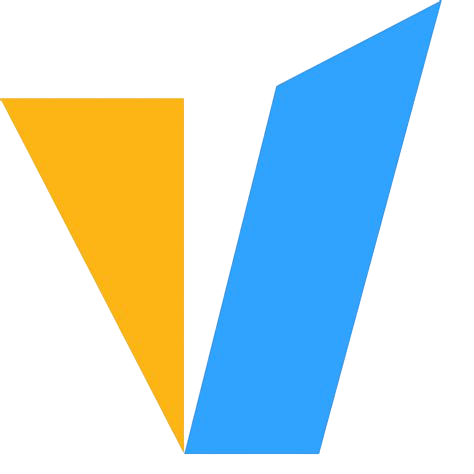
      vLLM
      Motor eficiente para inferencia de LLMs
    

    

      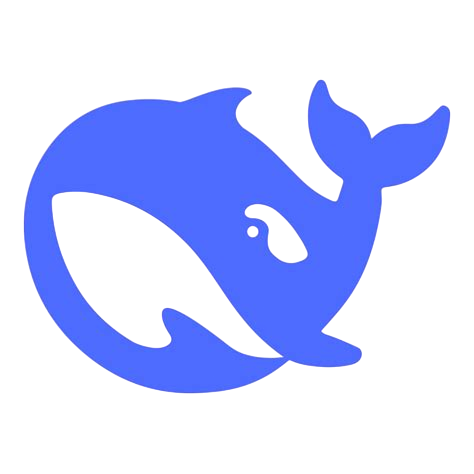
      DeepSeek-Chat
      Modelo open source de alto rendimiento
    

    

      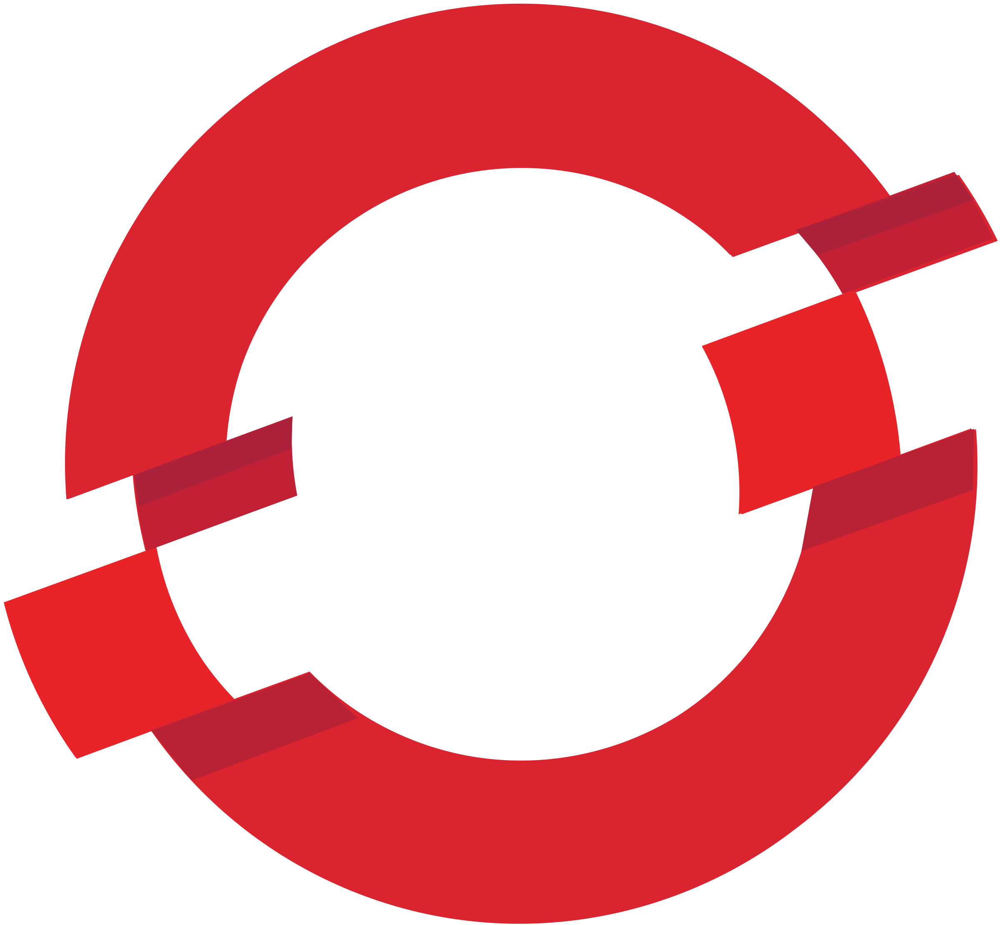
      OpenShift
      Orquestador con enfoque SRE y escalabilidad
    

  

---
title: Metodología y Enfoque
layout: top-title
side: l
color: amber-light

titlewidth: is-4
align: lm

transition: slide-left
---

:: title ::
# Metodología y Enfoque

:: content :: 

  

    

      
      Notion
      Gestión de tareas y documentación
    

    

      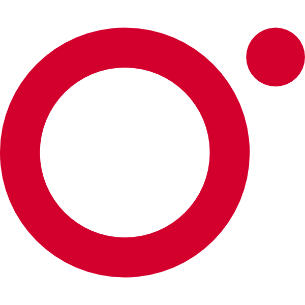
      O'Reilly
      Guía de referencia técnica
    

    

      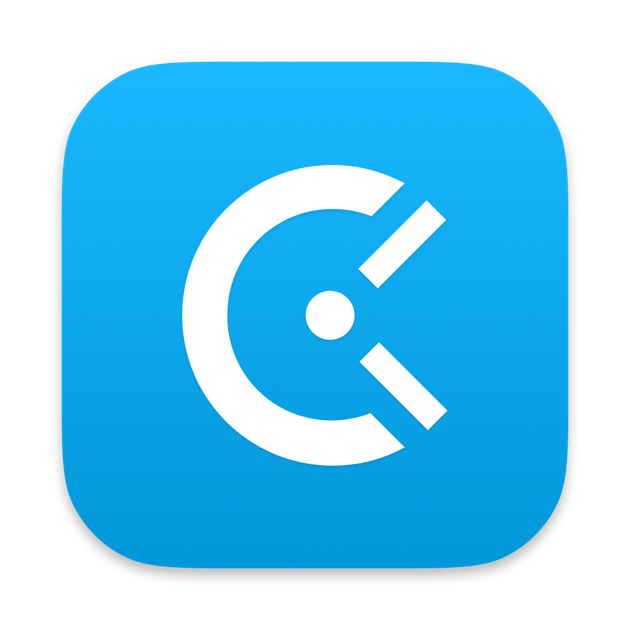
      Clockify
      Seguimiento de tiempos
    

  

  

    

      
      Erasmus
      Experiencia internacional en TI
    

    

      
      Red Hat
      Curso Red Hat Openshift D0180
    

  

---
title: Metodología del Proyecto y Recursos de Apoyo II 
layout: full
color: amber-light

transition: slide-left
---

  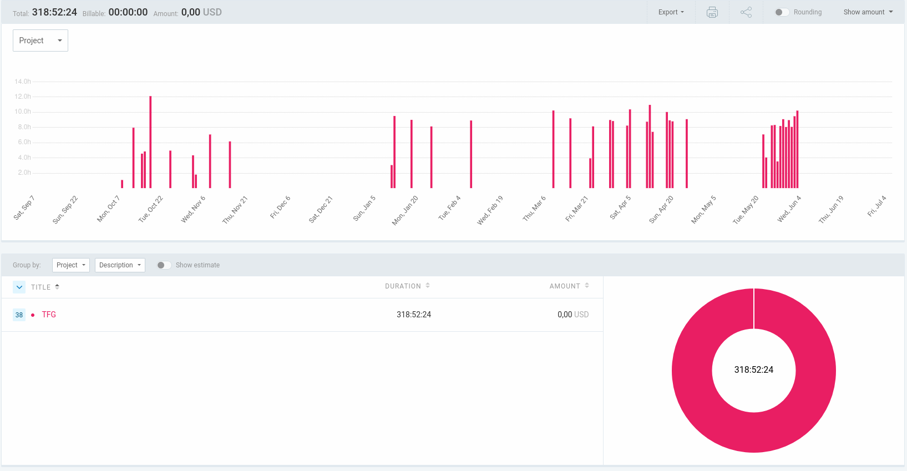
  <figcaption class="text-center text-sm mt-2" style="color: #f59e42; font-weight: 600;">
    Diagrama de las horas registradas por Clockify
  </figcaption>

---
title: Recursos y Costos Estimados

layout: top-title-two-cols
color: amber-light

align: l-lm-lm
columns: is-6

transition: slide-left
---
:: title ::
# Recursos y Costos Estimados

:: right ::
- Hardware Principal: GPU NVIDIA L40S y Servidor Dell PowerEdge R7615.
- Costos Asociados: Infraestructura adicional y horas de trabajo.
- Estimación: Proyecto de alto costo (&gt;10.000&nbsp;€).
- Viabilidad: Gracias al apoyo institucional.

:: left ::

  <figure class="flex flex-col items-center">
    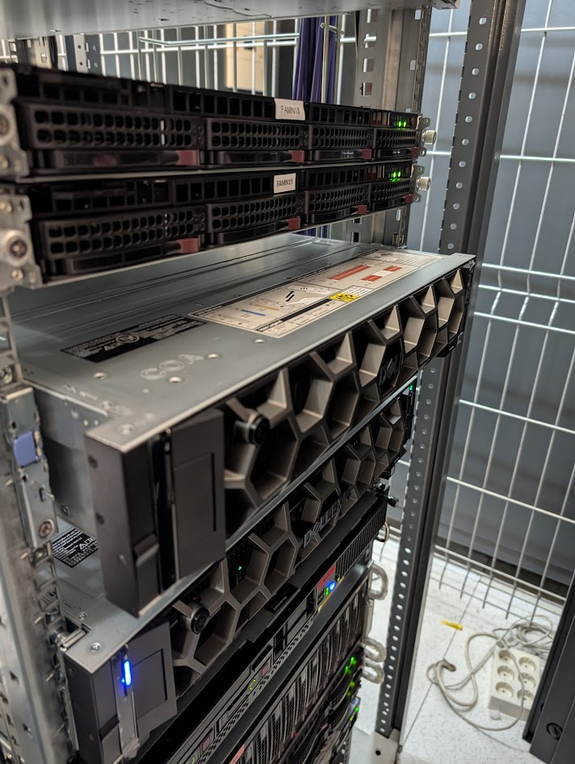
      <figcaption class="text-center text-sm text-gray-600">
      Dell PowerEdge R7615 en el rack.
    </figcaption>
  </figure>

---
layout: cover
color: lime
---

# Montaje y Configuración de Hardware

:: note ::

\* Capítulo 4

---
title: Primer contacto con la infraestructura

layout: top-title-two-cols
color: lime-light

align: l-lm-cm
columns: is-5

transition: slide-left
---

:: title ::
# Primer contacto con la infraestructura

:: left ::

- Servidor Asignado: Dell PowerEdge R7615 con GPU NVIDIA L40S.
- Puesta a Punto en el CTT: Integración en el rack y conexión de red.

:: right :: 

<figure class="flex flex-col justify-center h-full">
  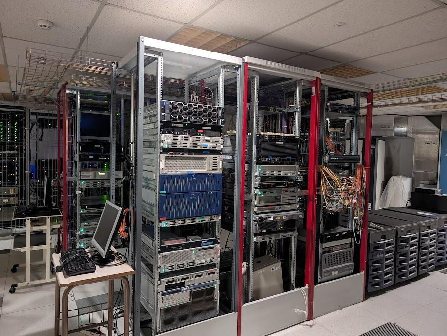
  <figcaption class="text-center text-sm text-gray-600" style="margin-top: 0.7rem;">
    Sala de servidores del CTT.
  </figcaption>
</figure>

---
title: Experiencia Práctica

layout: top-title-two-cols
color: lime-light

align: l-lm-cm
columns: is-5

transition: slide-left
---

:: title ::
# Experiencia Práctica

:: left ::
- Montajes y Cableado en Racks: Experiencia real 
- Resolución de Incidencias
- Lección Clave SRE: La Precaución y Seguridad en Operaciones Físicas.

:: right :: 

  <figure class="flex flex-col items-center">
    
  </figure>

---
title: Metodología del Proyecto y Recursos de Apoyo II 
layout: full
color: white

transition: slide-left
---

  

    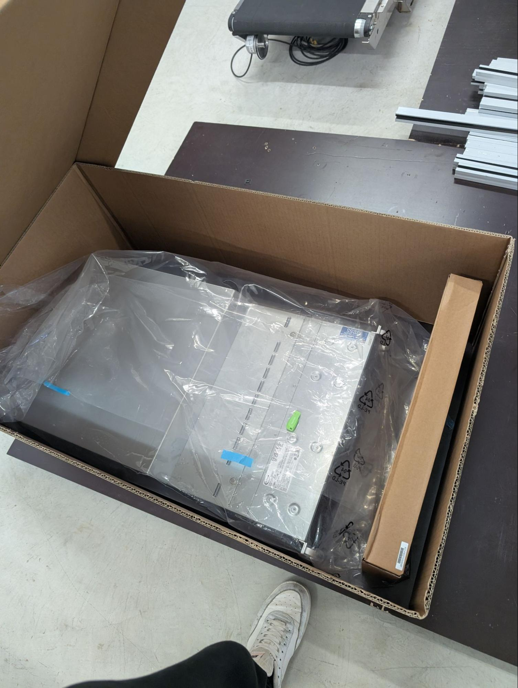
    <figcaption class="text-center text-sm mt-2 text-lime-600 font-semibold">
      Supermicro as-4124gs-tnr-03-wa0004 en Desion
    </figcaption>
  

  

    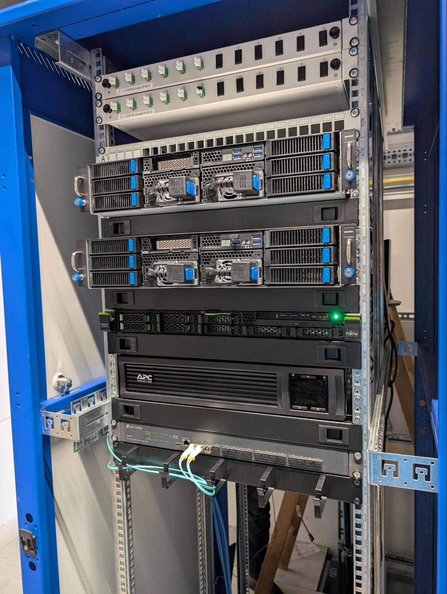
    <figcaption class="text-center text-sm mt-2 text-lime-600 font-semibold">
      Rack de Servidores de Schwechat (Austria)
    </figcaption>
  

  

    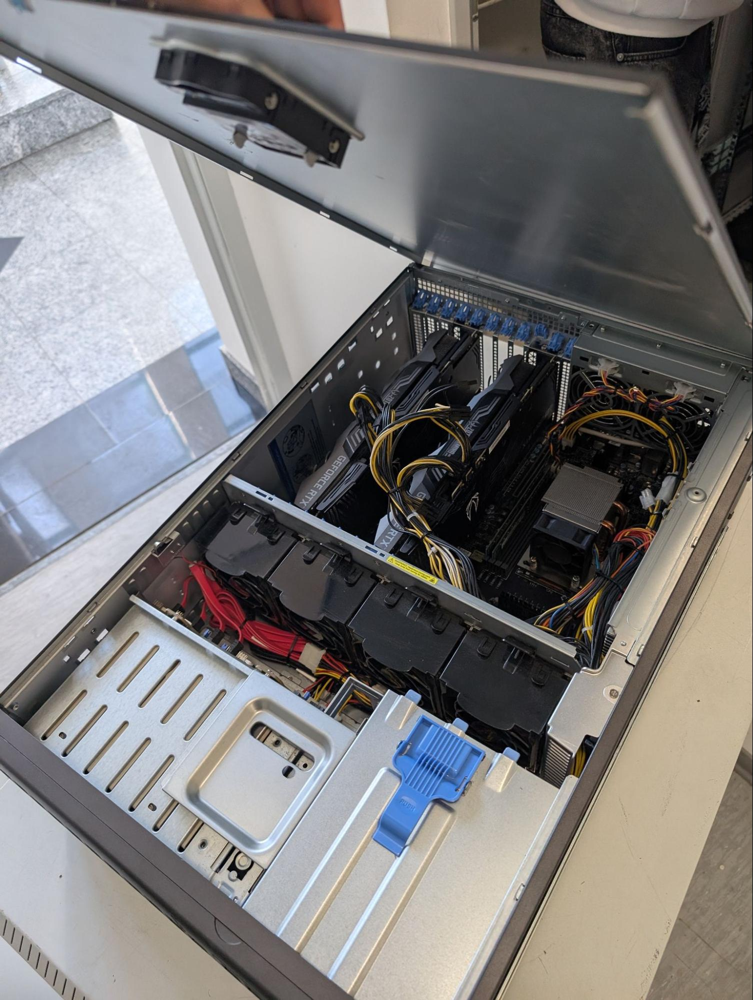
    <figcaption class="text-center text-sm mt-2 text-lime-600 font-semibold">
       Supermicro con 2 GPU 3090 en Desion
    </figcaption>
  

---
title: Acceso Remoto al Servidor Adaptación y Automatización
layout: top-title
side: l
color: lime-light

titlewidth: is-4
align: lm

transition: slide-left
---
:: title ::
# Acceso Remoto al Servidor

:: content ::

- Desafío: Conexión segura desde ubicación remota.
- Solución Implementada: Conexión SSH con doble salto.
- Enfoque SRE: Automatización del proceso (a través de <code>~/.ssh/config</code>).

  <figure class="flex flex-col items-center">
    
    <figcaption class="text-center text-sm text-gray-600 mt-2">
      Diagrama conexion SSH
    </figcaption>
  </figure>

---
title: Puesta a Punto del Sistema Operativo y Drivers

layout: top-title-two-cols
color: lime-light

align: l-lm-cm
columns: is-4

transition: slide-left
---

:: title ::
# Puesta a Punto del Sistema Operativo y Drivers

:: left ::

- SO: Fedora Server 
- Soporte GPU: Driver NVIDIA 570.133.07 y CUDA Toolkit 12.8 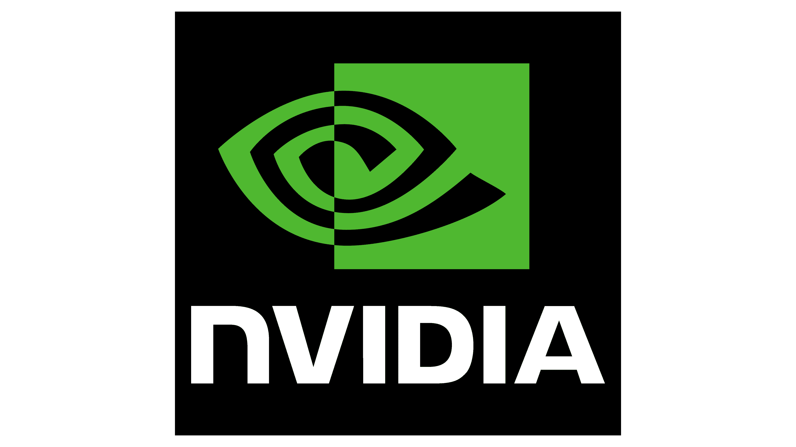
- Problemas: Manejo de reinicios y configuración de Secure Boot.

:: right :: 
<figure class="flex flex-col justify-center h-full">
  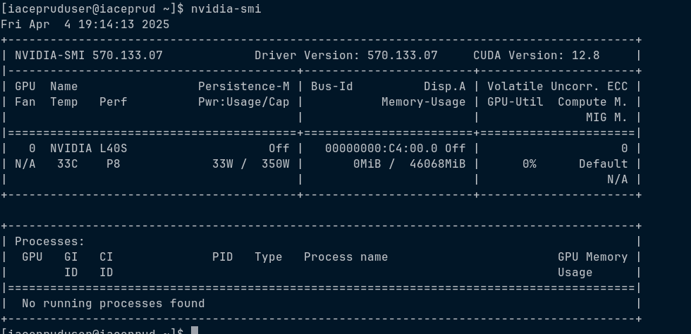
  <figcaption class="text-center text-sm text-gray-600" style="margin-top: 0.7rem;">
    nvidia-smi output
  </figcaption>
</figure>

---
layout: cover
color: red
---

# Despliegue y Evaluación de LLM

:: note ::

\* Capítulo 5 y 6

---
title: Comparativa de LLM

layout: top-title-two-cols
color: red-light

align: l-cm-lm
columns: is-8

transition: slide-left
---

:: title ::
# Comparativa de LLM

:: left ::

<figure class="flex flex-col justify-center h-full">
  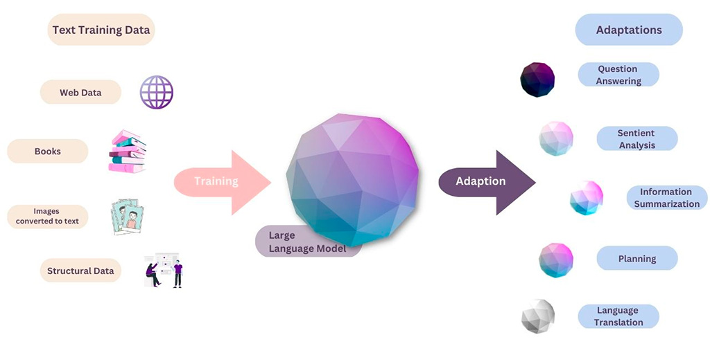
  <figcaption class="text-center text-sm text-gray-600" style="margin-top: 0.7rem;">
    Vision Conceptual de un LLM
  </figcaption>
</figure>

:: right :: 
- Modelos: DeepSeek-Chat (67B y 7B) en GPU NVIDIA L40S (48&nbsp;GB VRAM). Comparar ambos.
- Solución Inicial: Despliegue con Podman (Alternativa a Docker, Modo Rootless).
- Desafío Principal: Requisitos de VRAM (67B en FP16 &gt; 120&nbsp;GB).

---
title: Cuantización 

layout: side-title
color: red-light
side: l
titlewidth: is-4
align: lm-lm

transition: slide-left
---

:: title ::
# ¿Cómo optimizar un modelo que no cabe?

:: content ::

- Cuantización INT4: QLoRA
- Reducción de 124&nbsp;GB → 31&nbsp;GB
- vLLM + PagedAttention → inferencia concurrente
- Resultado: Ejecución estable del modelo 67B

  <figure class="flex flex-col items-center">
    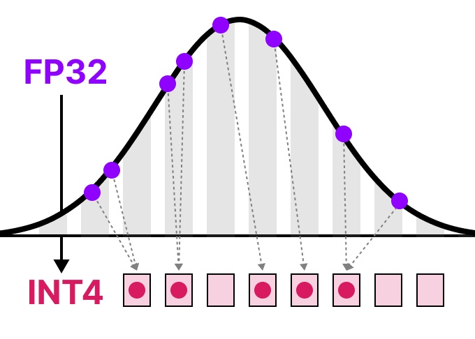
    <figcaption class="text-center text-sm text-gray-600" style="margin-top: 0.7rem;">
      Concepto de Cuantificación
    </figcaption>
  </figure>

<!--  
* La imagen ilustra el concepto de cuantificación mostrando cómo un rango continuo de valores (representado por la curva negra y los puntos morados para FP32) se mapea a un conjunto discreto y limitado de valores (representado por los puntos rojos en las cajas INT4).
 *
 * Específicamente:
 *
 * - FP32 (Punto Flotante de 32 bits): La parte superior de la imagen, etiquetada como "FP32", representa valores con alta precisión. La curva negra suave simboliza una distribución continua de posibles valores, y los puntos morados en la curva representan valores específicos en este formato de mayor precisión.
 * - INT4 (Entero de 4 bits): La parte inferior, etiquetada como "INT4", muestra el resultado de la cuantificación, donde los valores se reducen a un formato entero de menor precisión (enteros de 4 bits). Las flechas grises discontinuas indican que los valores originales de FP32 se redondean o se mapean al valor discreto INT4 más cercano disponible. Los puntos rojos dentro de las cajas vacías representan estos valores cuantificados. Las cajas en blanco indican que algunos valores de la distribución continua original pueden mapearse al mismo valor cuantificado, o que hay menos valores únicos disponibles en la representación INT4 en comparación con FP32.
 *
 * En el contexto de los LLMs, esta imagen explica visualmente cómo los pesos y las activaciones de un modelo de lenguaje grande, que normalmente utilizan números de punto flotante de alta precisión (como FP32), se convierten en enteros de menor precisión (como INT4). Este proceso, conocido como cuantificación, reduce significativamente el tamaño del modelo y el uso de memoria, haciéndolo más eficiente para el despliegue y la inferencia, especialmente en hardware con recursos limitados. 
 * -->

---
title: Port Forwarding
layout: top-title
side: l
color: red-light

titlewidth: is-2
align: lm

transition: slide-left
---
:: title ::
# Port Forwarding

:: content ::

  <!-- Columna izquierda: texto y diagrama, ahora más estrecha -->
  

    

      <ul class="list-disc pl-5">
        <li>
          Acceso a la API: (localhost:8000) del LLM desde máquina local.
        </li>
        <li>
          Implementación: SSH Tunneling para redirección de puerto.
        </li>
        <li>
          Ventaja: Acceso seguro y directo al servicio LLM.
        </li>
      </ul>
    

    

      <figure class="flex flex-col items-center w-full">
        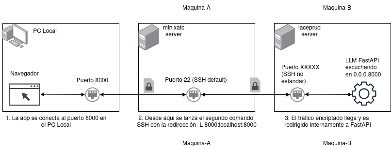
      </figure>
    

  

  <!-- Columna derecha: imagen fastapi más grande y centrada verticalmente -->
  

    <figure class="flex flex-col items-center w-full">
      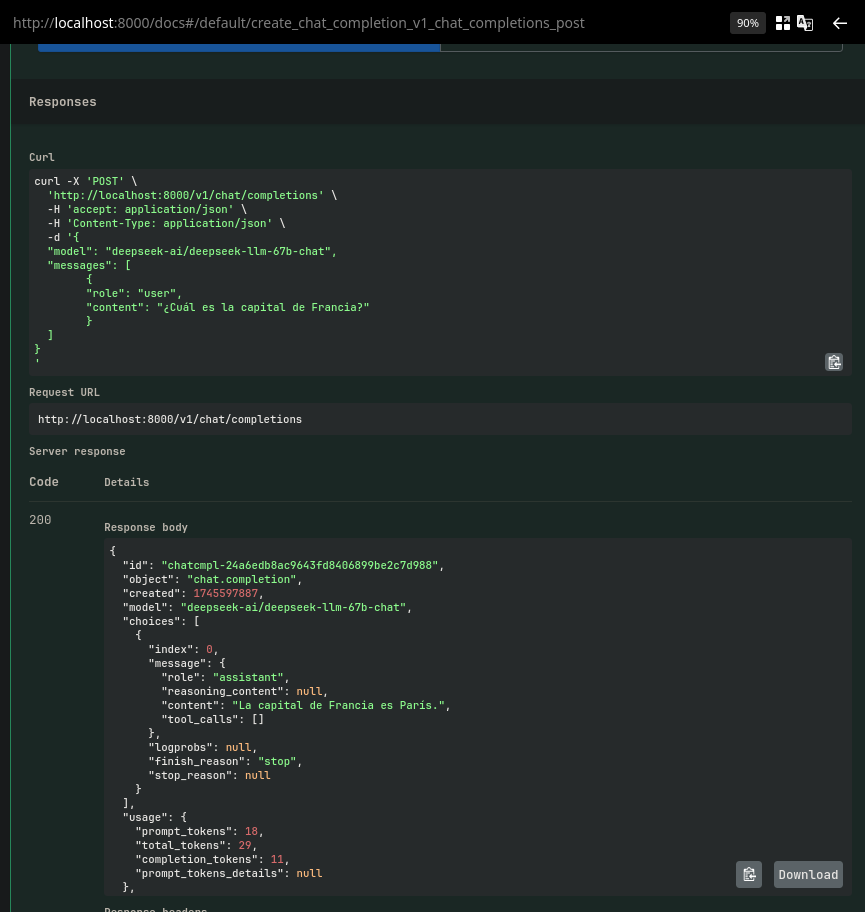
      <figcaption class="text-center text-sm text-gray-600 mt-2">
        Terminal SSH mostrando FastAPI en ejecución
      </figcaption>
    </figure>
  

---
title: Evaluación de Rendimiento Metodología

layout: top-title-two-cols
color: red-light

align: l-lm-cm
columns: is-6

transition: slide-left
---

:: title ::
# Evaluación de Rendimiento: Metodología

:: left ::
<ul class="space-y-2 list-disc ml-6 pt-10">
  <li>Métricas Clave: Throughput (TPS), latencia y tasa de error.</li>
  <li>Herramienta: Apache JMeter para simular usuarios concurrentes.</li>
  <li>Acceso: Túnel SSH para redirección segura de puertos.</li>
  <li>Formula TPS</li>
</ul>

$$
\mathrm{TPS} = \frac{\text{Solicitudes}}{\text{segundo}} \times \left( \text{tokens}_{\text{prompt}} + \text{tokens}_{\text{respuesta}} \right)
$$

:: right :: 
<figure class="flex flex-col justify-center h-full">
  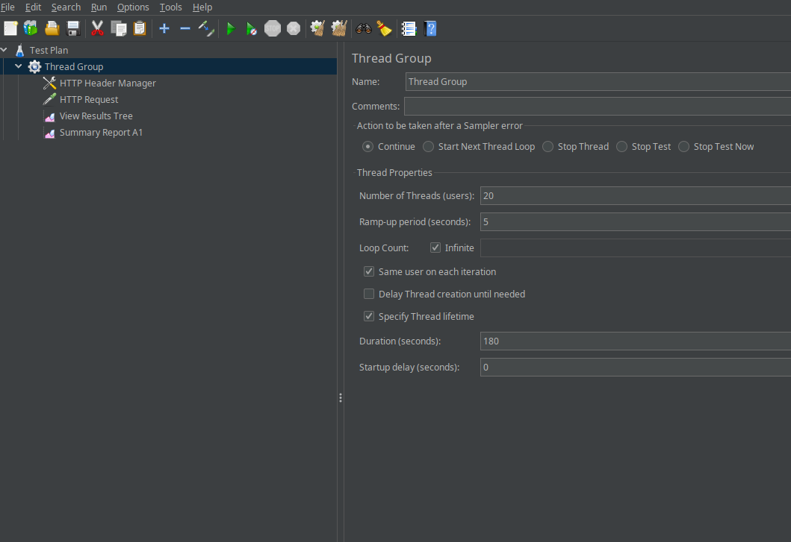
  <figcaption class="text-center text-sm text-gray-600" style="margin-top: 0.7rem;">
    JMeter Benchmarking
  </figcaption>
</figure>

---
title: Escenarios de Prueba 

layout: top-title
side: l
color: red-light

titlewidth: is-4
align: lm

transition: slide-left
---
:: title ::
# Escenarios de Prueba 

:: content ::

  

    Escenario A
    
      Evaluación de Latencia y Consistencia 
      Respuestas Cortas (32 tokens) y Carga Baja (10–20 hilos)
    
  

  

    Escenario B
    
      Evaluación de Estabilidad 
      Respuestas Medias-Largas (64–256 tokens) y Carga Media (15 hilos)
    
  

  

    Escenario C
    
      Búsqueda del Throughput Máximo 
      Respuestas Largas y Carga Alta (hasta 50 hilos)
    
  

:: left ::

---
title: Resultados Latencia

layout: top-title-two-cols
color: red-light

align: l-lm-cm
columns: is-5

transition: slide-left
---

:: title ::
# Resultados: Latencia

:: left ::

- Modelo 7B: Latencia significativamente menor y más estable.
- Modelo 67B: Aumento exponencial de latencia con la carga.
- Lower is better

:: right :: 
<figure class="flex flex-col justify-center h-full">
  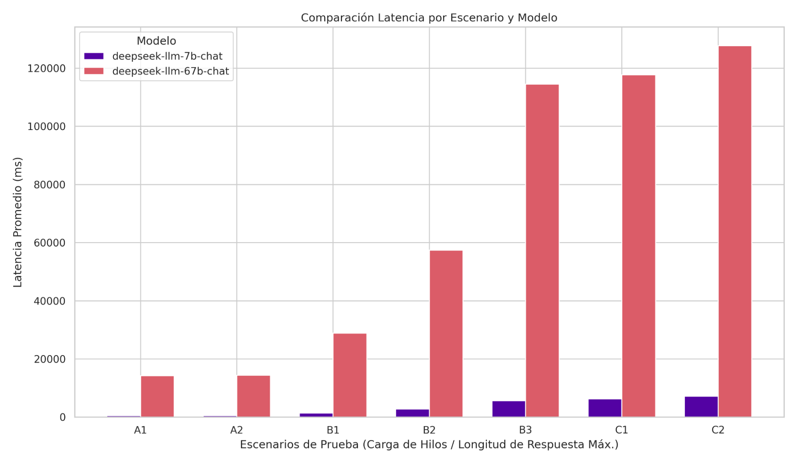
  <figcaption class="text-center text-sm text-gray-600" style="margin-top: 0.7rem;">
    Grafica Resultados Latencia
  </figcaption>
</figure>

---
title: Resultados Throughput (TPS)

layout: top-title-two-cols
color: red-light

align: l-lm-cm
columns: is-5

transition: slide-left
---

:: title ::
# Resultados: Throughput (TPS)

:: left ::
- Modelo 7B: Alto throughput y escalabilidad superior.
- Modelo 67B: Throughput limitado.
- Higher is better

:: right :: 
<figure class="flex flex-col justify-center h-full">
  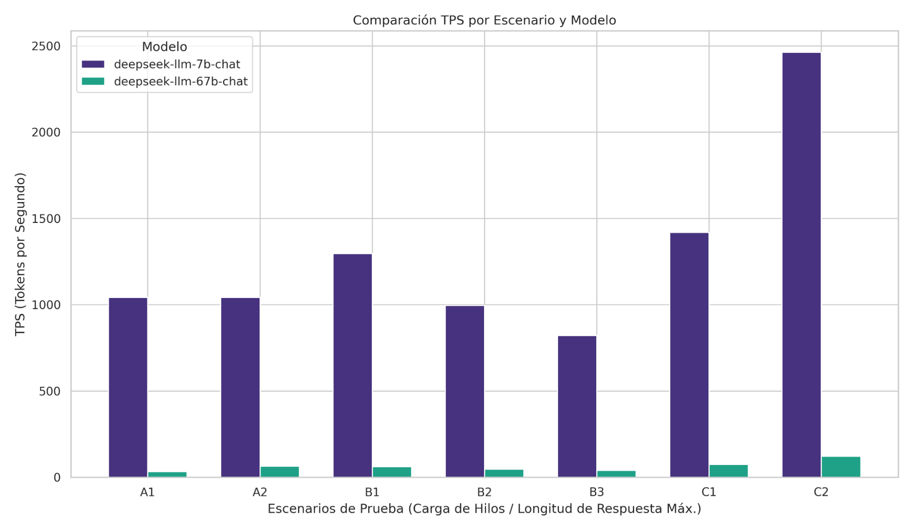
  <figcaption class="text-center text-sm text-gray-600" style="margin-top: 0.7rem;">
    Grafica Resultados TPS
  </figcaption>
</figure>

---
title: Conclusiones de la Evaluación de Rendimiento
layout: top-title-two-cols
color: red-light

align: l-cm-lm
columns: is-6

transition: slide-left
---
:: title ::
# Conclusiones de la Evaluación de Rendimiento

:: right ::

- ¿Son resultados plausibles? Pensamiento crítico.
- Visto: 100% uso GPU y ~96% VRAM en todos los escenarios del 67B (según NVIDIA-SMI).
- Compromiso: Trade-off claro entre el tamaño del modelo y la eficiencia.

:: left ::

  <figure class="flex flex-col items-center">
    
  </figure>

---
layout: cover
color: indigo
---

# Gestión Operativa con Enfoque SRE

:: note ::

\* Capítulo 7

---
title: ¿Por qué OpenShift?

layout: top-title-two-cols
color: indigo-light

align: l-lm-cm
columns: is-4

transition: slide-left
---

:: title ::
# ¿Por qué OpenShift?

:: left ::
- Limitaciones de Despliegue Manual: Falta de monitoreo, recuperación y escalado automático.
- Alineado con la filosofía SRE. 

:: right :: 
<figure class="flex flex-col justify-center h-full">
  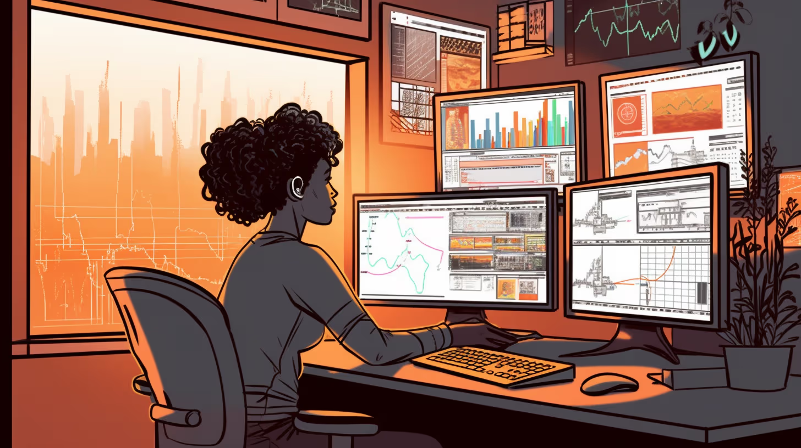
</figure>

---
title: Gestión Operativa Transición a OpenShift 

layout: top-title-two-cols
color: indigo-light

align: l-lm-cm
columns: is-5

transition: slide-left
---

:: title ::
# Gestión Operativa: Transición a OpenShift 

:: left ::
- Más que Kubernetes
- Características Clave: Declarativa, Reproducible, Escalable.
- Funcionalidades Integradas: Autoescalado, Probes de Salud, CI/CD, Namespaces, Métricas (Prometheus, Grafana).
- Ideal para: Servicios Fiables y Mantenibles.

:: right :: 
<figure class="flex flex-col justify-center h-full">
  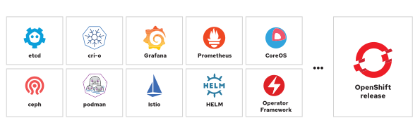
  <figcaption class="text-center text-sm text-gray-600" style="margin-top: 0.7rem;">
     Proyectos de código abierto que hay en OpenShift
  </figcaption>
</figure>

---
title: Despliegue paso a paso

title: Herramientas Clave
layout: top-title
side: l
color: indigo-light

titlewidth: is-4
align: lm

transition: slide-left
---

:: title ::
# Despliegue paso a paso

:: content ::

  

    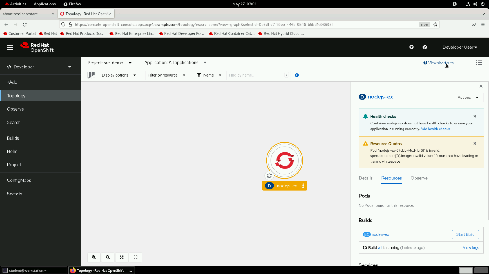
    <figcaption class="text-center text-sm text-gray-600" style="margin-top: 0.7rem;">
      oc new-app https://github.com/sclorg/nodejs-ex --name=nodejs-ex
    </figcaption>
  

  

    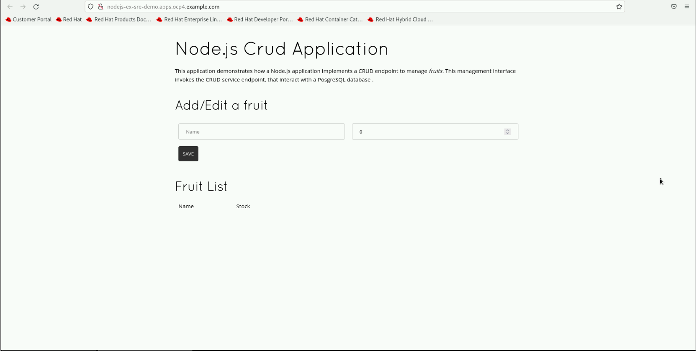
    <figcaption class="text-center text-sm text-gray-600" style="margin-top: 0.7rem;">
      oc expose service nodejs-ex 
    </figcaption>
  

---
title: Despliegue paso a paso

layout: top-title
side: l
color: indigo-light

titlewidth: is-4
align: lm

transition: slide-left
---

:: title ::
# Despliegue paso a paso II 

:: content ::

  

    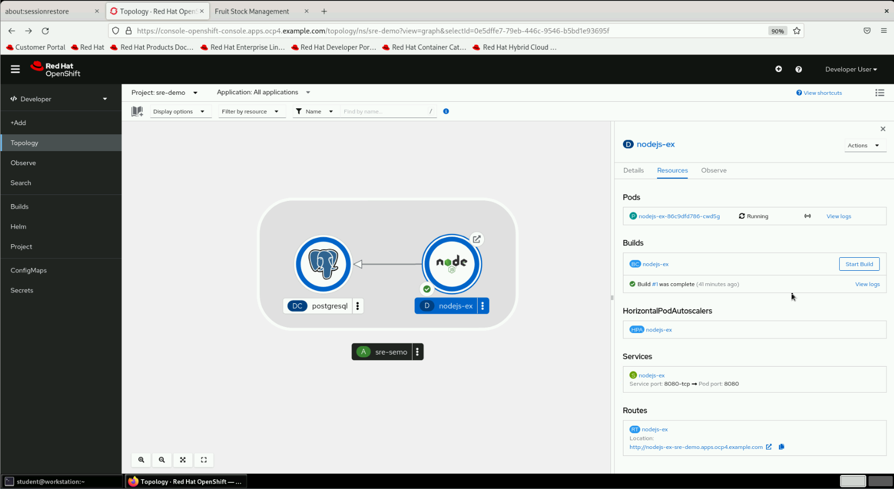
    <figcaption class="text-center text-sm text-gray-600" style="margin-top: 0.7rem;">
      oc new-app postgresql-persistent ...
    </figcaption>
  

  

    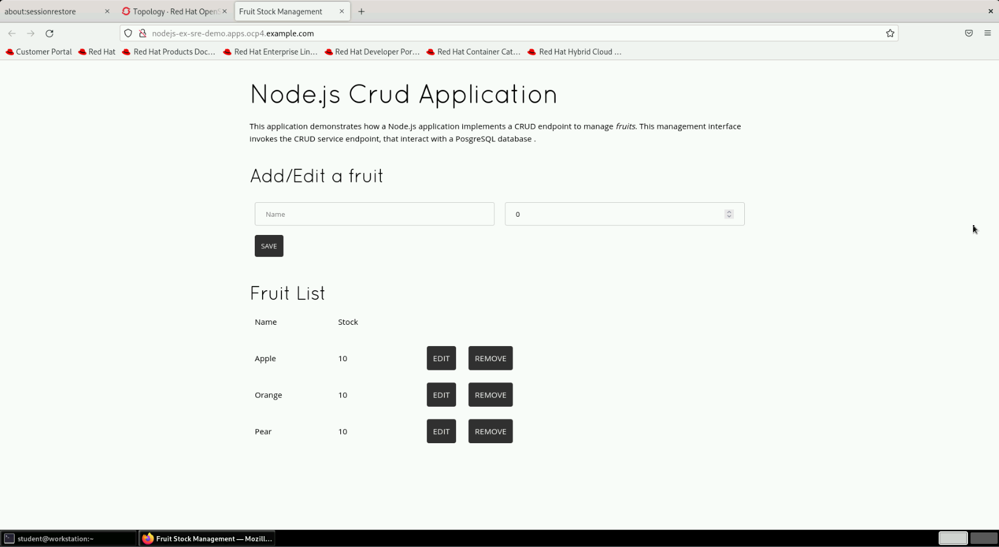
    <figcaption class="text-center text-sm text-gray-600" style="margin-top: 0.7rem;">
      Aplicación desplegada 
    </figcaption>
  

---
title: Autoescalado y recuperación comportamiento esperado

layout: top-title
side: l
color: indigo-light

titlewidth: is-4
align: lm

transition: slide-left
---

:: title ::
# oc autoscale

:: content ::

  <figure class="flex flex-col items-center w-[320px]">
    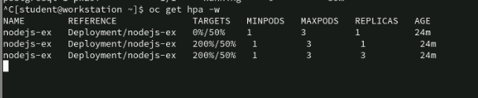
    <figcaption class="text-center text-sm text-gray-600 mt-2">
      El HPA incrementa a 3 réplicas tras mantener la carga al 200&nbsp;%.
    </figcaption>
  </figure>

  <figure class="flex flex-col items-center w-[320px]">
    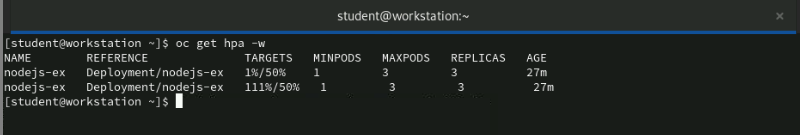
    <figcaption class="text-center text-sm text-gray-600 mt-2">
      Estado de los pods durante la prueba de carga
    </figcaption>
  </figure>

  <figure class="flex flex-col items-center w-[320px]">
    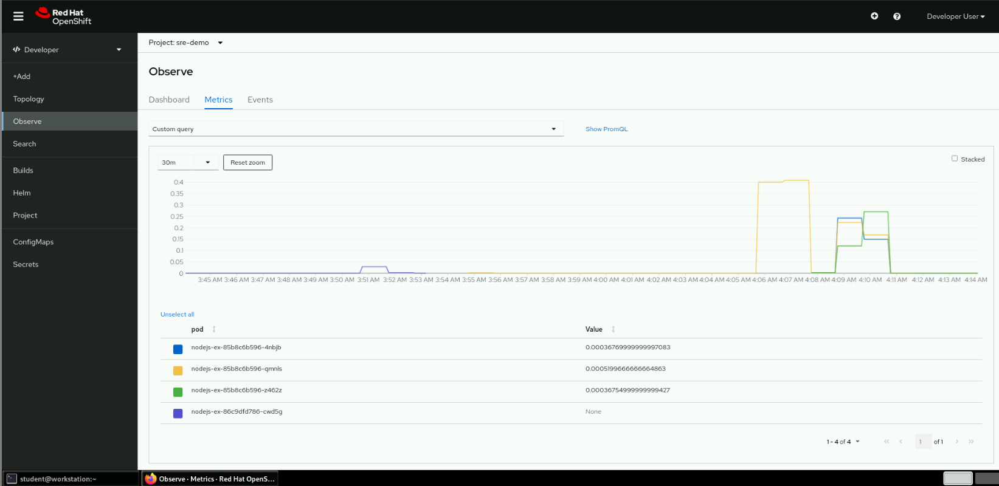
    <figcaption class="text-center text-sm text-gray-600 mt-2">
      Monitorización de los pods durante la prueba de carga
    </figcaption>
  </figure>

  <figure class="flex flex-col items-center w-[320px]">
    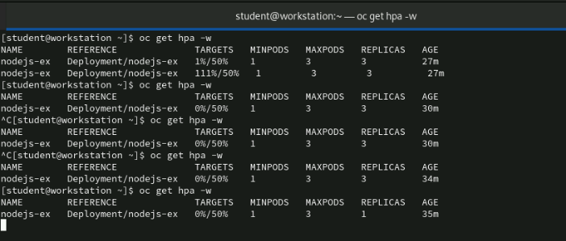
    <figcaption class="text-center text-sm text-gray-600 mt-2">
      Decrecimiento del autoescalado tras la prueba de carga.
    </figcaption>
  </figure>

---
title: Autoescalado y recuperación comportamiento esperado

layout: top-title
side: l
color: indigo-light

titlewidth: is-4
align: lm

transition: slide-left
---

:: title ::
# oc set probe + oc set triggers

:: content ::

  <figure class="flex flex-col items-center w-[320px]">
    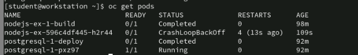
    <figcaption class="text-center text-sm text-gray-600 mt-2">
      Estado CrashLoopBackOff tras fallo en la sonda de readiness 
    </figcaption>
  </figure>
  <figure class="flex flex-col items-center w-[320px]">
    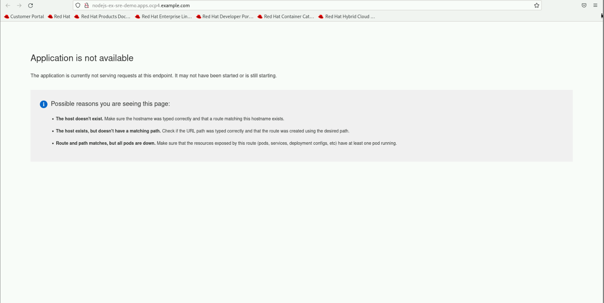
    <figcaption class="text-center text-sm text-gray-600 mt-2">
      Aplicacion no disponible por culpa del cambio de puerto
    </figcaption>
  </figure>

  <code>oc set triggers bc/nodejs-ex --from-github=true --auto</code>

---
title: Conclusiones Finales

layout: top-title
side: l
color: amber-light

titlewidth: is-4
align: lm

transition: slide-left
---

:: title ::
# Conclusiones Finales

:: content ::

  <!-- Infraestructura -->
  

    

      ✔️
    

    

      Infraestructura
      Servidor HPC funcional con GPU L40S.
    

  

  <!-- Contenedores -->
  

    

      🤖
    

    

      Contenedores
      Ejecución de LLMs (67B y 7B) en contenedores.
    

  

  <!-- Benchmarking -->
  

    

      📊
    

    

      Benchmarking
      Evaluación realista del rendimiento.
    

  

  <!-- Automatización -->
  

    

      ⚙️
    

    

      Automatización
      Orquestación con enfoque SRE.
    

  

---
title: Trabajo a Futuro
layout: side-title
color: amber-light

side: right
titlewidth: is-3
align: lm-lm

transition: slide-left
---
:: title ::
# Trabajo a Futuro

:: content ::

  

    

      Escalabilidad
      🖥️
      Ampliar el sistema con más GPUs o nodos HPC.
    

  

  

    

      Multi-Modelo
      🧩
      Comparar despliegue de varios modelos simultáneos usando Triton.
    

  

  

    

      Bare Metal
      🛠️
      Instalar OpenShift bare metal para soporte completo de GPU.
    

  

  

    

      SRE Avanzado
      ⚙️
      Profundizar en prácticas SRE y explorar despliegues más complejos en OpenShift.
    

  

---
layout: cover
color: amber
---

# ¡Gracias por vuestra atención!

  Fin de la presentación. 
  ¿Preguntas o comentarios?

:: note ::

